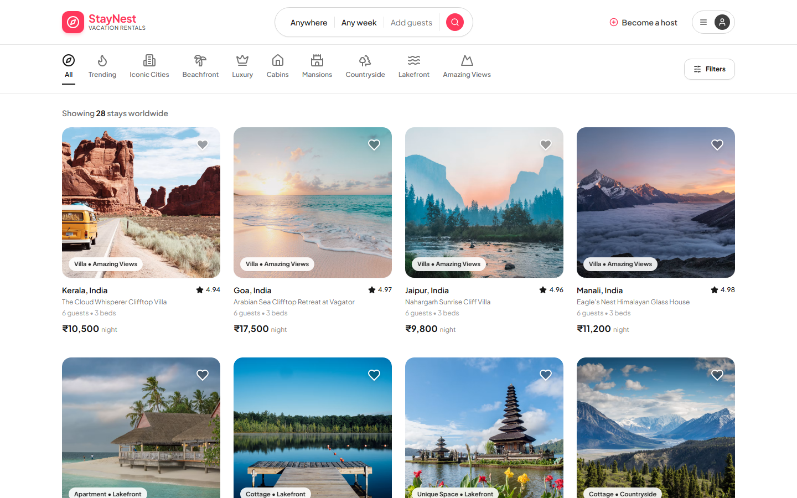
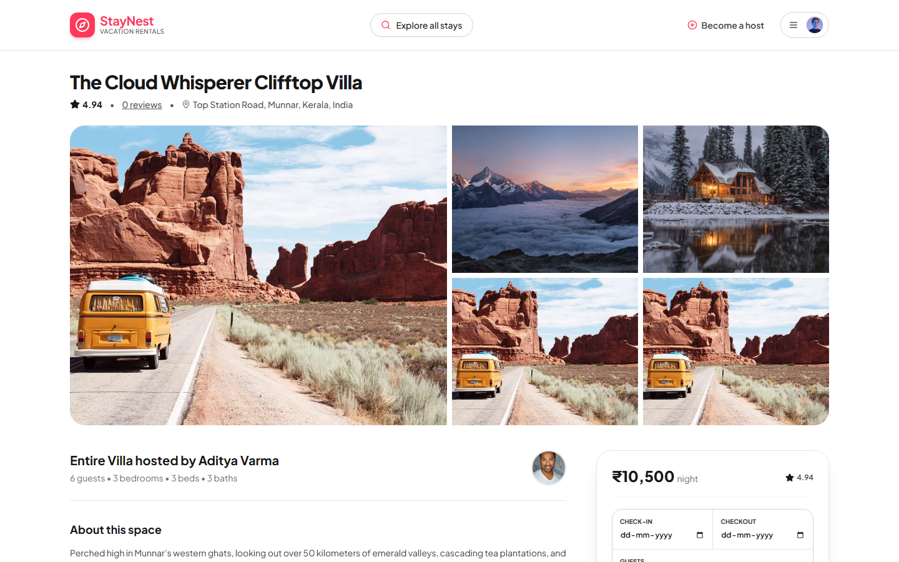
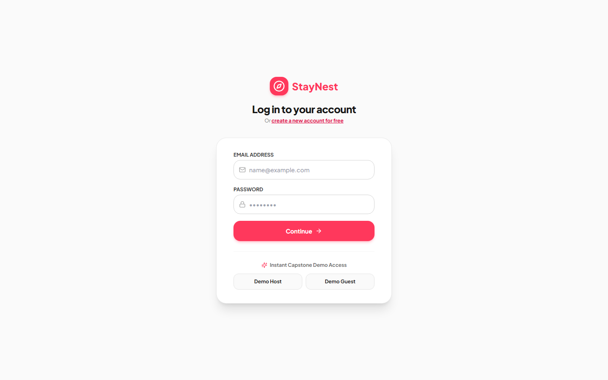
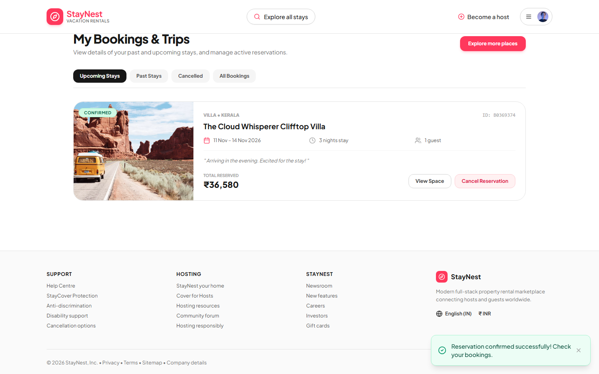
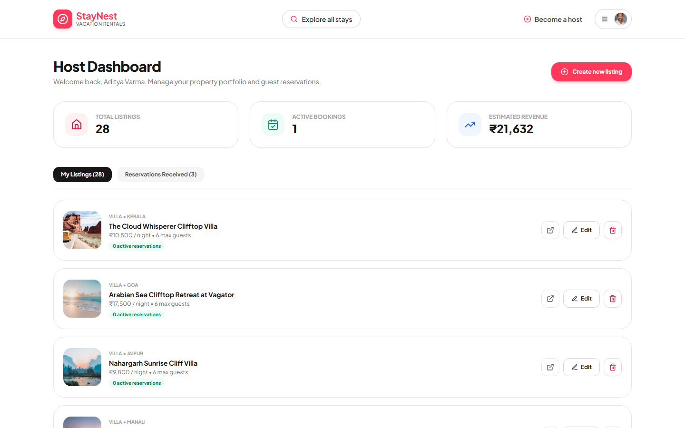
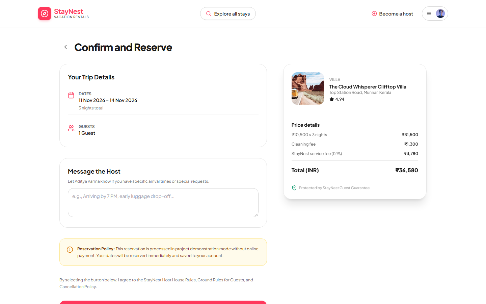
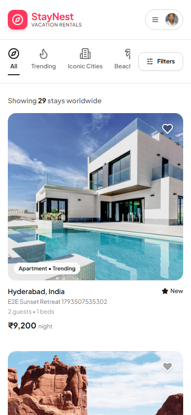
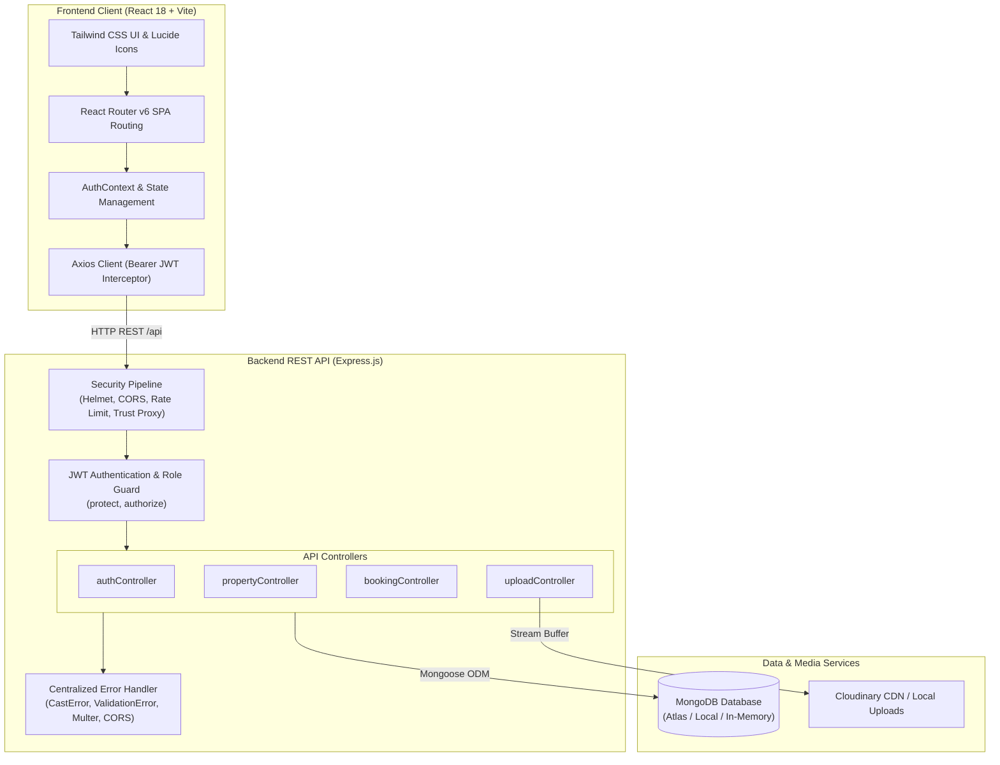
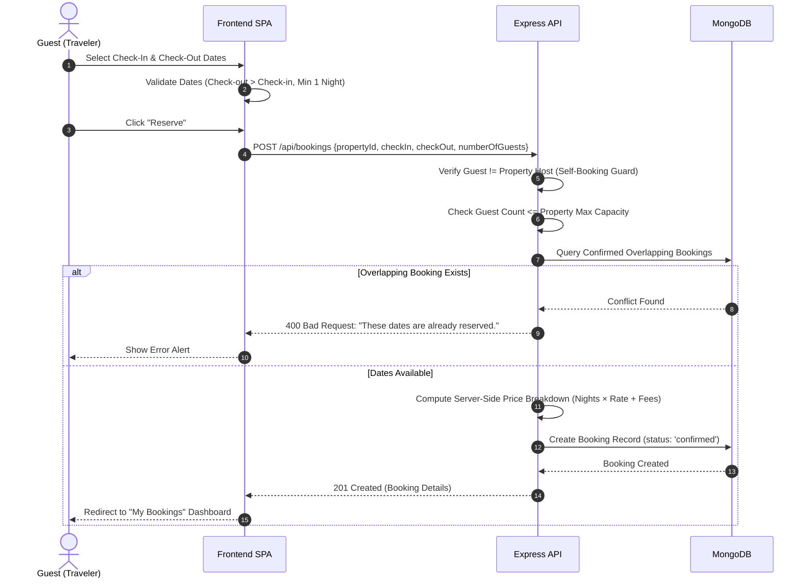

# StayNest — Full-Stack Vacation Rental Marketplace

<div align="center">



### Modern Property Rental Platform Inspired by Airbnb
**Full-Stack MERN Internship Capstone Project**

[](https://reactjs.org/)
[](https://vitejs.dev/)
[](https://tailwindcss.com/)
[](https://nodejs.org/)
[](https://expressjs.com/)
[](https://www.mongodb.com/)
[](https://jwt.io/)
[](https://jestjs.io/)
[](https://opensource.org/licenses/MIT)

[Overview](#-project-overview) • [Key Features](#-key-features) • [Screenshots](#-screenshots-and-application-preview) • [Tech Stack](#-technology-stack) • [Architecture](#-system-architecture) • [Setup](#-installation-and-setup) • [API Docs](#-api-documentation) • [Testing](#-testing-and-quality-assurance) • [Deployment](#-deployment-guide)

</div>

---

## 📖 Table of Contents

- [1. Project Title and Introduction](#staynest--full-stack-vacation-rental-marketplace)
- [2. Project Overview](#-project-overview)
- [3. Key Features](#-key-features)
  - [Guest Experience](#guest-experience)
  - [Host Experience](#host-experience)
- [4. Screenshots and Application Preview](#-screenshots-and-application-preview)
- [5. Technology Stack](#-technology-stack)
- [6. System Architecture](#-system-architecture)
- [7. Project Folder Structure](#-project-folder-structure)
- [8. Prerequisites](#-prerequisites)
- [9. Installation and Setup](#-installation-and-setup)
- [10. Environment Variables](#-environment-variables)
- [11. Running the Application](#-running-the-application)
- [12. Demo Accounts](#-demo-accounts)
- [13. Database Seeding](#-database-seeding)
- [14. API Documentation](#-api-documentation)
- [15. Booking Workflow and Validation](#-booking-workflow-and-validation)
- [16. Testing and Quality Assurance](#-testing-and-quality-assurance)
- [17. Security Features](#-security-features)
- [18. Deployment Guide](#-deployment-guide)
- [19. Future Improvements](#-future-improvements)
- [20. Author and Project Information](#-author-and-project-information)

---

## 🌟 Project Overview

**StayNest** is an enterprise-grade, full-stack vacation rental marketplace web application developed as an internship capstone project. Inspired by industry standards set by Airbnb, StayNest bridges property hosts with travelers across India and worldwide.

The platform provides an end-to-end booking experience: travelers can explore curated accommodations, filter across nine distinct categories and multiple cities, check live calendar availability, review pricing breakdowns with server-side validation, and manage their trips. Property hosts can list new spaces, upload multiple photos, manage pricing, inspect incoming guest reservations, and edit their listings in real time.

Built on the **MERN** stack (MongoDB, Express, React, Node.js), StayNest emphasizes architectural separation of concerns, zero-friction local development with automatic in-memory database fallback, automated double-booking prevention, strict security hardening, and responsive design across desktop, tablet, and mobile viewports.

---

## 🚀 Key Features

### Guest Experience
- **Interactive Search & Multi-Filter System**:
  - Filter by city/destination (e.g., *Hyderabad, Goa, Manali, Jaipur, Pondicherry, Bangalore, Mumbai, Kerala*).
  - Categorical filtering across **9 distinct themes** (*Trending, Iconic Cities, Beachfront, Luxury, Cabins, Mansions, Countryside, Lakefront, Amazing Views*).
  - Price slider with minimum and maximum ceilings in Indian Rupees (₹ INR).
  - Property type selector (*Apartment, Villa, House, Cottage, Cabin, Studio*).
  - Guest capacity filtering.
  - Active filter badges with individual removal and one-click "Clear all" filter reset.
- **Dynamic Accommodation Exploration**:
  - Interactive pagination across property catalogs.
  - High-resolution photographic galleries with responsive grid layouts.
  - Comprehensive amenity badges with iconography (Wi-Fi, Pool, Workspace, Kitchen, Fireplace, etc.).
  - Host profile summary, house rules, and verified guest reviews.
- **Live Reservation Calculator**:
  - Interactive check-in and check-out date picker with calendar bounds.
  - Automatic computation of stay duration (nights), base accommodation total, cleaning fee, and 12% service fee.
- **Trip & Reservation Lifecycle**:
  - Transparent checkout summary screen before reservation confirmation.
  - **My Bookings Dashboard**: View upcoming trips, completed stays, and cancelled reservations.
  - Instant self-service booking cancellation with immediate calendar date release.
- **Verified Guest Reviews**: Post star ratings (1–5) and written feedback on accommodations.

### Host Experience
- **Dedicated Host Dashboard**:
  - Top-line business analytics: *Total Properties*, *Active Reservations*, and *Estimated Payout Revenue*.
  - **My Listings tab**: View, update, or remove hosted accommodations with live reservation indicators.
  - **Reservations Received tab**: View guest profiles, check-in/out schedules, guest counts, and total booking values.
- **Streamlined Property Publishing**:
  - 5-step intuitive listing creation form covering basic details, location, specifications, amenities, and nightly pricing.
  - Instant **"Add Sample Photos"** injection for rapid prototyping and demonstration.
  - Multi-image file upload via Multer with Cloudinary integration and local disk fallback.
- **Full Listing Control**: Edit existing listings, update nightly rates, adjust cleaning fees, or delete listings.
- **Role Scalability**: Any registered user can host properties without separate disjointed accounts.

---

## 📸 Screenshots and Application Preview

All screenshots represent the verified live application captured during end-to-end browser evaluation:

| View | Screenshot Preview | Description |
|:---:|:---:|:---|
| **Home Page** |  | Property catalog showing 28 listings across 9 categories, search bar, and filter controls. |
| **Property Details** |  | High-res photo gallery, host details, amenities list, verified reviews, and sticky booking widget. |
| **Authentication** |  | Clean login interface featuring 1-click **Demo Host** and **Demo Guest** instant access buttons. |
| **Guest Dashboard** |  | Guest trip manager showing confirmed reservations, dates, pricing, and self-service cancellation. |
| **Host Dashboard** |  | Property management portal with revenue metrics, active listings, and incoming reservations. |
| **Booking Confirmation** |  | Transparent checkout breakdown showing nightly rates, cleaning fees, service fee, and guest notes. |
| **Mobile Responsive** |  | Responsive mobile viewport (390 × 844) with mobile navigation and responsive cards. |

---

## 💻 Technology Stack

| Layer | Technology | Version | Purpose |
|---|---|---|---|
| **Frontend Framework** | **React.js** | 18.3.1 | Component-driven Single Page Application (SPA) UI |
| **Build Tool** | **Vite** | 6.0.11 | Fast HMR dev server and optimized production bundler |
| **Styling** | **Tailwind CSS** | 3.4.17 | Utility-first responsive design and custom design system |
| **Icons** | **Lucide React** | 0.474.0 | Modern, lightweight icon suite |
| **Routing** | **React Router DOM** | 6.28.1 | Client-side declarative routing and protected routes |
| **HTTP Client** | **Axios** | 1.7.9 | Promised-based HTTP client with auth interceptors |
| **Backend Runtime** | **Node.js** | 20+ / 24+ | Asynchronous event-driven server runtime |
| **Web Framework** | **Express.js** | 4.21.2 | Modular REST API routing and middleware pipeline |
| **Database** | **MongoDB** | 8.0+ | NoSQL document database |
| **ODM** | **Mongoose** | 8.9.5 | Schema definition, validation, and query orchestration |
| **Authentication** | **JWT & bcryptjs** | 9.0 / 3.0 | Stateless Bearer token verification and password hashing |
| **File Processing** | **Multer** | 1.4.5 | Multipart/form-data upload handling (5MB limit) |
| **Cloud Storage** | **Cloudinary** | 2.5.1 | Persistent CDN image hosting with local disk fallback |
| **Security** | **Helmet & Rate-Limit** | 8.0 / 7.5 | HTTP security headers and brute-force throttling |
| **Automated Testing** | **Jest & Supertest** | 29.7 / 7.0 | Automated unit and integration testing (44 tests) |
| **E2E Testing** | **Puppeteer Core** | 25.16.0 | Headless browser end-to-end automation test suite |

---

## 🏛 System Architecture



---

## 📂 Project Folder Structure

```
StayNest-Airbnb/
├── client/                                # React 18 + Vite Frontend
│   ├── public/                            # Static assets
│   ├── src/
│   │   ├── components/
│   │   │   └── common/                    # Navbar, CategoryFilter, PropertyCard, Modals, Footer
│   │   ├── context/                       # AuthContext, ToastContext
│   │   ├── pages/                         # Home, Details, Book, Add, Edit, Dashboards, Auth
│   │   ├── services/                      # Axios API client with token interceptor
│   │   ├── App.jsx                        # Application routes and route guards
│   │   ├── index.css                      # Tailwind base, components, and utilities
│   │   └── main.jsx                       # React entry point
│   ├── index.html                         # HTML template
│   ├── tailwind.config.js                 # Tailwind CSS design tokens
│   ├── vercel.json                        # Vercel SPA routing rewrite rules
│   ├── vite.config.js                     # Vite build configuration
│   └── package.json                       # Frontend dependencies & scripts
├── server/                                # Express.js REST API Backend
│   ├── config/
│   │   ├── db.js                          # Mongoose connection with in-memory fallback
│   │   └── cloudinary.js                  # Cloudinary image hosting configuration
│   ├── controllers/                       # Business logic for auth, properties, bookings, reviews
│   ├── data/
│   │   └── demoProperties.js              # 28 curated properties across 9 categories & 8 regions
│   ├── middleware/                        # JWT protect, roles, Multer upload, centralized error handler
│   ├── models/                            # Mongoose schemas: User, Property, Booking, Review
│   ├── routes/                            # Modular Express routers
│   ├── scripts/
│   │   └── seed.js                        # Standalone idempotent database seeding CLI script
│   ├── tests/                             # Automated test suites
│   │   ├── api.test.js                    # 21 unit & integration tests
│   │   └── categoryFilters.test.js        # 23 filter, pagination, & search tests
│   ├── uploads/                           # Local file upload directory (git-ignored)
│   ├── utils/
│   │   └── autoSeed.js                    # Startup seeder with production safety guards
│   ├── app.js                             # Express application configuration
│   ├── server.js                          # Server bootstrap & graceful shutdown listener
│   └── package.json                       # Backend dependencies & scripts
├── screenshots/                           # 7 verified application screenshots
├── tests/
│   └── e2eBrowser.js                      # Complete Puppeteer end-to-end browser test runner
├── .env.example                           # Root environment variable template
├── .gitignore                             # Comprehensive Git exclusion rules
├── DEPLOYMENT.md                          # Production deployment checklist & instructions
├── PROJECT_STATUS.md                      # Milestone history & test audit logs
├── render.yaml                            # Render Infrastructure-as-Code Blueprint
├── vercel.json                            # Root Vercel deployment configuration
└── package.json                           # Root workspace orchestration scripts
```

---

## 📋 Prerequisites

Ensure your local development environment has the following installed:

- **Node.js**: v18.0.0 or higher (v20+ recommended). Check with:
  ```bash
  node -v
  ```
- **npm**: v9.0.0 or higher. Check with:
  ```bash
  npm -v
  ```
- **Git**: Installed and configured. Check with:
  ```bash
  git --version
  ```
- **MongoDB** *(Optional)*: A local MongoDB instance or a cloud MongoDB Atlas connection string. If omitted, StayNest automatically provisions a zero-friction **in-memory MongoDB instance** during development.
- **Cloudinary Account** *(Optional)*: Free account at [cloudinary.com](https://cloudinary.com) for cloud image hosting. If omitted, StayNest safely uses local disk storage and curated CDN photography.

---

## ⚙️ Installation and Setup

### 1. Clone the Repository
```bash
git clone https://github.com/saidevaharsha07-art/StayNest-Airbnb.git
cd StayNest-Airbnb
```

### 2. Install Dependencies
Install root, client, and server dependencies in one standard sequence:

```bash
# Install root orchestration tools
npm install

# Install frontend dependencies
npm install --prefix client

# Install backend dependencies
npm install --prefix server
```

*(Alternatively, run the convenience script: `npm run install:all`)*

---

## 🔐 Environment Variables

StayNest uses environment variable templates to keep private credentials secure. Copy the template files to create your active `.env` configurations:

### Server Environment (`server/.env`)
Create `server/.env` based on `server/.env.example`:

```env
# Server Port & Mode
PORT=5000
NODE_ENV=development

# Allowed Client Origin (for CORS)
CLIENT_URL=http://localhost:5173

# Database Connection String
# Leave as local URI to use local MongoDB or automatic in-memory fallback:
MONGODB_URI=mongodb://127.0.0.1:27017/staynest
# For production (MongoDB Atlas):
# MONGODB_URI=mongodb+srv://<username>:<password>@cluster0.xxxx.mongodb.net/staynest?retryWrites=true&w=majority

# JWT Authentication
JWT_SECRET=replace_with_a_secure_random_secret_at_least_32_chars
JWT_EXPIRES_IN=7d

# Image Hosting (Optional Cloudinary Configuration)
# If left blank, the server safely stores uploads locally in server/uploads/
CLOUDINARY_CLOUD_NAME=
CLOUDINARY_API_KEY=
CLOUDINARY_API_SECRET=

# Database Seeding Control
# Set to 'true' in production to auto-populate the 28 demo listings on first boot
SEED_DEMO_DATA=false
```

### Client Environment (`client/.env`)
Create `client/.env` based on `client/.env.example`:

```env
# Backend REST API Endpoint
VITE_API_URL=http://localhost:5000/api
```

> **Security Guarantee**: Real `.env` files are ignored by `.gitignore` and are never committed to version control.

---

## 🏃 Running the Application

### Concurrent Full-Stack Development
Start both the Express backend API and the Vite React frontend with a single command from the root directory:

```bash
npm run dev
```

Once started:
- **Frontend SPA**: `http://localhost:5173`
- **Backend REST API**: `http://localhost:5000/api`
- **API Health Check**: `http://localhost:5000/api/health`

### Running Services Individually
```bash
# Run only backend (with nodemon hot-reload)
npm run dev --prefix server

# Run only frontend (with Vite HMR)
npm run dev --prefix client
```

### In-Memory MongoDB Fallback
When developing locally without a running MongoDB service, StayNest automatically initializes an in-memory database (`mongodb-memory-server`) and auto-seeds the full 28-property catalog. This allows mentors, teammates, and recruiters to clone and evaluate the application immediately with zero database configuration.

---

## 👥 Demo Accounts

StayNest includes pre-configured demo credentials accessible via **1-click buttons** on the login page:

| Role | Name | Email Address | Password | Permissions |
|---|---|---|---|---|
| **Demo Host** | Aditya Varma | `host@staynest.com` | `password123` | Publish listings, edit/delete listings, view incoming reservations, view host analytics. |
| **Demo Guest** | Priya Sharma | `guest@staynest.com` | `password123` | Explore stays, filter properties, reserve dates, view trips in My Bookings, cancel reservations. |

*You can also register a brand new account at `/register`.*

---

## 🌱 Database Seeding

The database seeder populates **28 premier properties** across 8 Indian regions (*Hyderabad, Goa, Manali, Jaipur, Pondicherry, Bangalore, Mumbai, Kerala*) ensuring every one of the 9 categories has 3 to 4 properties.

### Run Seed Command Manually
```bash
npm run seed
```

### Seeder Capabilities:
1. **Idempotent Upserting**: Re-running the seeder never creates duplicates. Properties are matched by title.
2. **Account Preservation**: Existing user accounts and guest booking histories are preserved.
3. **Reset Flag**: To perform a clean reset of demo data:
   ```bash
   node server/scripts/seed.js --reset
   ```
4. **Production Guard**: In production (`NODE_ENV=production`), auto-seeding is disabled by default unless explicitly permitted via `SEED_DEMO_DATA=true`.

---

## 📡 API Documentation

### Base URL: `http://localhost:5000/api`

### 1. Authentication Endpoints
| Method | Endpoint | Access | Description |
|---|---|---|---|
| `POST` | `/api/auth/register` | Public | Register a new user (`name`, `email`, `password`, `role`). |
| `POST` | `/api/auth/login` | Public | Authenticate user; returns JWT token and user profile. |
| `GET` | `/api/auth/me` | Private | Retrieve authenticated user profile via Bearer token. |
| `PUT` | `/api/auth/profile` | Private | Update user profile details (`name`, `phone`, `bio`, `profileImage`). |

### 2. Property Endpoints
| Method | Endpoint | Access | Description |
|---|---|---|---|
| `GET` | `/api/properties` | Public | List properties with pagination (`page`, `limit`), `category`, `location`, `minPrice`, `maxPrice`, `propertyType`, and `guests`. |
| `GET` | `/api/properties/:id` | Public | Retrieve detailed property information by ID. |
| `POST` | `/api/properties` | Private (Host) | Create a new property listing with image URLs, nightly rate, and amenities. |
| `PUT` | `/api/properties/:id` | Private (Host) | Update an owned property listing. Prevents non-owners from editing. |
| `DELETE` | `/api/properties/:id` | Private (Host) | Permanently delete an owned property listing. |
| `GET` | `/api/properties/host/my-listings` | Private (Host) | Retrieve all listings owned by the logged-in host. |

### 3. Booking Endpoints
| Method | Endpoint | Access | Description |
|---|---|---|---|
| `POST` | `/api/bookings` | Private (Guest)| Create a reservation. Enforces date validation and prevents double-booking. |
| `GET` | `/api/bookings/my` | Private (Guest)| Retrieve all bookings created by the logged-in guest. |
| `GET` | `/api/bookings/host` | Private (Host) | Retrieve all guest reservations placed on the host's listings. |
| `GET` | `/api/bookings/:id` | Private (Party) | Retrieve a specific booking by ID (accessible only by guest or host). |
| `PATCH` | `/api/bookings/:id/cancel` | Private (Party) | Cancel a booking. Releases dates on the calendar immediately. |
| `GET` | `/api/bookings/property/:id/booked-dates` | Public | Get active booked date ranges to disable on the frontend calendar. |

### 4. Review & Media Upload Endpoints
| Method | Endpoint | Access | Description |
|---|---|---|---|
| `GET` | `/api/properties/:id/reviews` | Public | Retrieve all verified reviews and ratings for a property. |
| `POST` | `/api/properties/:id/reviews` | Private (Guest)| Post a verified review (1–5 stars and written review). |
| `POST` | `/api/upload` | Private (Host) | Upload up to 10 images (JPEG, PNG, WEBP) via Multer/Cloudinary. |
| `GET` | `/api/health` | Public | Health-check endpoint returning server status and uptime. |

---

## 🛡 Booking Workflow and Validation

StayNest implements strict server-side rules to ensure data consistency and prevent double-booking:



### Business Rules Enforced:
1. **Server-Side Price Calculation**: Nightly rates, stay duration, cleaning fees, and service fees (12%) are strictly computed on the server. Client-submitted prices are ignored.
2. **Agreed Price Snapshot**: Nightly prices are locked at booking time (`pricePerNightAtBooking`). Future host price adjustments never alter existing confirmed reservations.
3. **Self-Booking Guard**: Hosts are prevented from reserving their own properties.
4. **Concurrency & Overlap Query**:
   ```javascript
   const conflictingBooking = await Booking.findOne({
     property: propertyId,
     status: 'confirmed',
     checkIn: { $lt: requestedCheckOut },
     checkOut: { $gt: requestedCheckIn }
   });
   ```
5. **Immediate Date Release**: When a booking is cancelled, its status updates to `'cancelled'`, freeing the dates immediately for other guests.

---

## 🧪 Testing and Quality Assurance

StayNest includes both backend automated tests and browser end-to-end (E2E) suites.

### Backend Automated Test Suite (44 Tests)
Powered by **Jest** and **Supertest** with an in-memory database:

```bash
npm run test:server
```

```
PASS tests/categoryFilters.test.js (6.024 s)
PASS tests/api.test.js (4.797 s)

Test Suites: 2 passed, 2 total
Tests:       44 passed, 44 total
Snapshots:   0 total
Time:        9.474 s
Ran all test suites.
```

- **`tests/api.test.js` (21 Tests)**:
  - Authentication: User registration, password hashing, duplicate email rejection, invalid password handling, `/api/auth/me` profile retrieval, unauthenticated rejection.
  - Property Operations: Unauthorized property creation guard, host property creation, pagination & filtering, single property retrieval, unauthorized edit guard, owner edit verification.
  - Booking Business Logic: Self-booking guard, date range validation, guest capacity limits, server-side pricing verification, concurrent overlap rejection, guest bookings retrieval, host reservations retrieval, booking cancellation.
- **`tests/categoryFilters.test.js` (23 Tests)**:
  - Validates all 9 categories return matching properties.
  - Validates city filtering across all 8 regions (*Hyderabad, Goa, Manali, Jaipur, Pondicherry, Bangalore, Mumbai, Kerala*).
  - Validates combined filters (Category + Location, Category + Price Range).
  - Validates search and "Clear all" filter reset.

### Browser End-to-End Suite (6 Suites)
Executed via **Puppeteer** in Google Chrome (`node tests/e2eBrowser.js`):
1. **Home Page & Pagination**: Verified 28 listings across 3 pages, all 9 categories, image loading, and "Clear all".
2. **Search & Advanced Filters**: Verified searches for "Hyderabad" (5 listings), "Goa" (3 listings), price ceiling (<= ₹8,000), and combined filters.
3. **Guest Experience**: Full lifecycle verification (Registration → Login → Details view → Booking widget → Checkout → My Bookings → Cancellation).
4. **Host Experience**: Full host lifecycle (Demo Host login → Dashboard analytics → New listing creation → Image upload → Price edit → Deletion).
5. **Responsive Design**: Inspected and verified mobile viewport (390 × 844) and tablet viewport (768 × 1024).
6. **Console & Quality Check**: **0 browser console error events** detected throughout testing.

---

## 🔒 Security Features

- **Password Hashing**: Passwords hashed with `bcryptjs` using 10 salt rounds. Plaintext passwords are never stored.
- **Query Stripping**: Password hashes are excluded from default Mongoose queries (`select: false`).
- **Stateless JWT Authorization**: Bearer tokens verified via Express middleware before protected actions.
- **Role Escalation Protection**: Public registration and profile edit endpoints prevent users from assigning themselves administrative roles.
- **HTTP Security Headers**: Configured with `helmet` for cross-origin resource policies, XSS prevention, and clickjacking mitigation.
- **Strict CORS Origin Validation**: Dynamic origin matching based on `CLIENT_URL` with support for comma-separated domains and Vercel preview URLs.
- **Brute-Force Rate Limiting**: Sensitive auth routes (`/api/auth/login`, `/api/auth/register`) are throttled by `express-rate-limit` (100 requests per 15 minutes).
- **Secure File Uploads**: Multer strictly verifies MIME types and extensions (`.jpeg`, `.jpg`, `.png`, `.webp`) and enforces a 5MB maximum file size limit.
- **Centralized Error Handling**: Detailed stack traces are hidden in production to prevent information leakage.
- **Credential Masking**: Database connection logs sanitize connection URIs so passwords are never exposed in server logs.

---

## 🚀 Deployment Guide

StayNest is fully configured and prepared for production deployment across **Render** (Backend API), **Vercel** (Frontend React SPA), and **MongoDB Atlas** (Cloud Database).

> For the comprehensive checklist and troubleshooting, see [DEPLOYMENT.md](DEPLOYMENT.md).

### 1. MongoDB Atlas (Cloud Database)
1. Create a free **M0 Sandbox cluster** at [mongodb.com](https://www.mongodb.com/cloud/atlas).
2. Create a Database User with password authentication and `readWriteAnyDatabase` privileges.
3. Under **Network Access**, add `0.0.0.0/0` (Allow access from anywhere).
4. Copy your SRV connection string:
   ```
   mongodb+srv://<username>:<password>@cluster0.xxxx.mongodb.net/staynest?retryWrites=true&w=majority
   ```

### 2. Backend Deployment on Render
1. In [Render Dashboard](https://dashboard.render.com), create a **New Web Service** pointing to your repository (or use the included `render.yaml` Blueprint).
2. Configure settings:
   - **Root Directory**: `server`
   - **Build Command**: `npm install`
   - **Start Command**: `node server.js`
   - **Health Check Path**: `/api/health`
3. Configure Environment Variables:
   - `NODE_ENV`: `production`
   - `PORT`: `10000`
   - `MONGODB_URI`: *Your MongoDB Atlas connection string*
   - `JWT_SECRET`: *A strong random 32+ character secret*
   - `JWT_EXPIRES_IN`: `7d`
   - `CLIENT_URL`: `https://your-frontend.vercel.app` *(Your Vercel URL)*
   - `SEED_DEMO_DATA`: `true` *(Seeds the 28 demo properties on initial startup)*
4. Deploy and copy your backend URL (e.g., `https://staynest-api.onrender.com`).

### 3. Frontend Deployment on Vercel
1. In [Vercel](https://vercel.com), import your repository.
2. Configure settings:
   - **Framework Preset**: `Vite`
   - **Root Directory**: `client` *(or repository root using the included `vercel.json`)*
   - **Build Command**: `npm run build`
   - **Output Directory**: `dist`
3. Set Environment Variable:
   - `VITE_API_URL`: `https://staynest-api.onrender.com/api`
4. Deploy. The bundled `client/vercel.json` rewrite rules ensure SPA routes (`/properties/:id`, `/bookings`, etc.) resolve properly on page refresh.

### 4. Local Unified Production Test
You can test the production build locally before cloud deployment:
```bash
# 1. Compile frontend production bundle
npm run build:client

# 2. Run Express in production mode serving the API and client/dist bundle
node server/server.js
```

---

## 🔮 Future Improvements

- **Payment Gateway Integration**: Integration of Stripe / Razorpay for live card, UPI, and net-banking transactions.
- **In-App Messaging**: Real-time WebSocket (Socket.io) messaging between hosts and guests.
- **Interactive Map Exploration**: Interactive Mapbox / Leaflet map view with pin clusters based on property GPS coordinates.
- **Automated Email Notifications**: Transactional emails for booking confirmations and host alerts via Nodemailer / SendGrid.
- **Calendar Synchronization**: iCal format export and import to synchronize availability with external calendars.

---

## 👨‍💻 Author and Project Information

- **Project**: StayNest Vacation Rental Marketplace (Airbnb Clone)
- **Course / Track**: Full-Stack MERN Web Development Internship Capstone
- **Author**: Sai Deva Harsha ([@saidevaharsha07-art](https://github.com/saidevaharsha07-art))
- **Repository**: [https://github.com/saidevaharsha07-art/StayNest-Airbnb](https://github.com/saidevaharsha07-art/StayNest-Airbnb)
- **License**: This project is licensed under the [MIT License](LICENSE).

---

<div align="center">
  <sub>Built with ❤️ as an Internship Capstone Project. StayNest is an independent educational clone and is not affiliated with, sponsored by, or endorsed by Airbnb, Inc.</sub>
</div>
